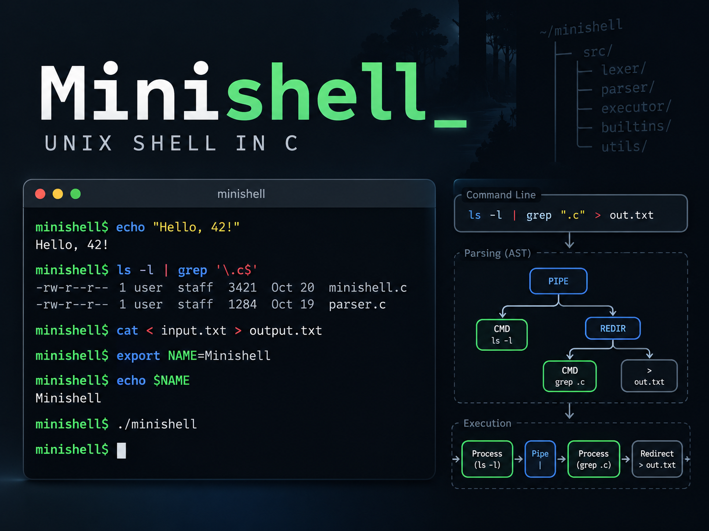

<p align="center">
  
</p>


# Minishell

**A Bash-inspired Unix shell built in C, from command parsing to process execution.**

Minishell is a systems programming project developed as part of the **1337 / 42 Network** curriculum. It recreates the essential behavior of a Unix command-line shell, with a focus on parsing, process control, inter-process communication, file descriptors, and signal handling.

Rather than invoking an existing shell to interpret commands, the project implements its own tokenizer, parser, expansion logic, and execution engine.

## Features

- **Interactive shell:** command prompt, input history, and terminal signal handling using GNU Readline.
- **Command parsing:** tokenization, single and double quotes, syntax validation, and an abstract syntax tree (AST).
- **Execution:** external commands, executable path resolution, and process management with `fork`, `execve`, and `waitpid`.
- **Pipelines:** connect commands through Unix pipes (`|`).
- **Redirections:** input (`<`), output (`>`), append (`>>`), and here-documents (`<<`).
- **Environment expansion:** variables such as `$HOME` and the previous command's exit status (`$?`).
- **Built-in commands:** `echo`, `cd`, `pwd`, `export`, `unset`, `env`, and `exit`.
- **Extended shell syntax:** logical operators (`&&`, `||`), parenthesized subshells, and basic `*` wildcard expansion.

## How It Works

```text
User input
    |
    v
Tokenizer  -->  Parser / AST  -->  Expansion  -->  Executor
                                                 |
                                +----------------+----------------+
                                |                |                |
                             Built-ins      Processes         Pipes / I/O
```

The **tokenizer** recognizes words, quoting, and shell operators. The **parser** organizes these tokens into an AST representing commands, pipelines, logical expressions, and subshells. During execution, the shell expands variables, prepares redirections and here-documents, runs built-ins, and launches external programs as needed.

### Project Structure

```text
42_Minishell/
├── includes/             # Shared headers and data structures
├── srcs/
│   ├── main.c            # Interactive shell loop and signals
│   ├── tokenizer/         # Lexical analysis
│   ├── parsing/           # AST construction and syntax handling
│   ├── env/               # Environment and variable expansion
│   ├── execution/         # Command execution and shell behavior
│   │   ├── ast/           # AST dispatch
│   │   ├── builtins/      # Built-in shell commands
│   │   ├── exec_command/  # External command execution
│   │   ├── pipes/         # Pipelines
│   │   ├── redirections/  # Input/output redirections
│   │   ├── subshell/      # Subshell execution
│   │   ├── utils/         # Execution helpers and here-documents
│   │   └── wildcards/     # Filename pattern matching
│   ├── cleaning/          # Resource cleanup
│   ├── get_next_line/     # Line-reading utilities
│   └── libft/             # Supporting C library
└── Makefile
```

## Build and Run

**Requirements:** a C compiler, `make`, and the GNU Readline development library.

```bash
git clone https://github.com/MohamedMorabet/42_Minishell.git
cd 42_Minishell
make
./minishell
```

**Readline configuration:** The current Makefile defaults to the 1337 campus Homebrew installation at `/goinfre/$(USER)/homebrew`. On other systems, specify the Readline prefix when building:

```bash
# Debian / Ubuntu (after installing build-essential and libreadline-dev)
make READLINE_PREFIX=/usr

# macOS with Homebrew
make READLINE_PREFIX="$(brew --prefix readline)"
```

Available Makefile targets:

| Command | Purpose |
| --- | --- |
| `make` | Build the `minishell` executable |
| `make clean` | Remove object files |
| `make fclean` | Remove object files and the executable |
| `make re` | Rebuild from scratch |

## Example Commands

Once inside `./minishell`, try:

```bash
# Built-ins and environment variables
pwd
export PROJECT=minishell
echo "Working on $PROJECT"

# Pipelines and redirections
ls -la | grep .c
echo "first line" > output.txt
echo "second line" >> output.txt
cat < output.txt

# Here-document
cat << EOF
Hello from Minishell
EOF

# Conditional execution and subshells
mkdir demo && cd demo
(false || echo "fallback command")

# Filename expansion
ls *.c

# Last command's exit status
echo $?
```

## Scope

Minishell implements a **subset of Bash behavior**, not a fully POSIX-compliant or drop-in Bash replacement. In particular, wildcard matching is basic, and advanced features such as job control and shell scripting are outside the project's scope.

## Technical Concepts

- Process creation and lifecycle management
- File descriptors, pipes, and I/O redirection
- Parsing and abstract syntax trees
- Environment variables and command expansion
- Unix signals and interactive terminal behavior
- Memory and resource management in C

## Contributors

Developed as a 42 team project by [Mohamed El-Morabet](https://github.com/MohamedMorabet) (`mel-mora`) and [@oel-mest](https://github.com/oel-mest).

---

*1337 Coding School · 42 Network*
